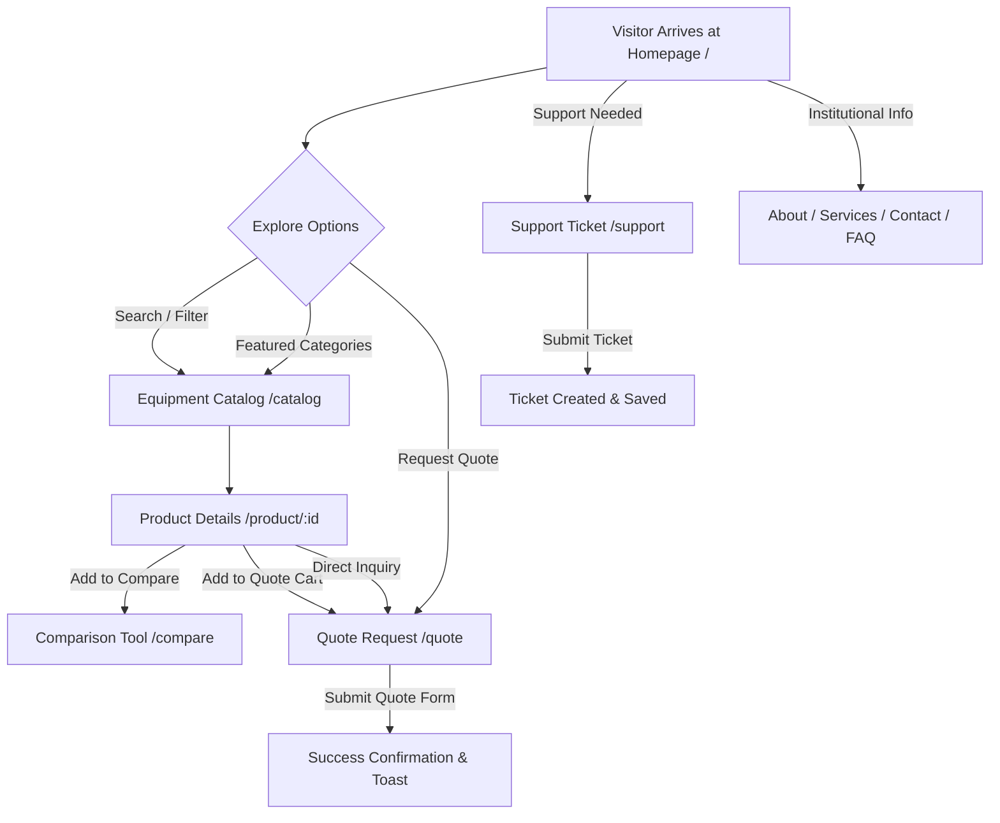

# Application Flow & Navigation Structure (App Flow)
## MediEquip360

---

## 1. Application Overview & Entry Points
MediEquip360 serves as a B2B portal where healthcare procurement officers, clinic administrators, and biomedical engineers can discover, compare, and request quotes for certified medical equipment.

### Primary Entry Points
- **Homepage (`/`):** Hero banner, featured equipment categories, promotional value propositions, top products, and quick search.
- **Equipment Catalog (`/catalog`):** Advanced filterable product search (category, price range, manufacturer, condition, compliance) with grid/list view toggles.
- **Product Details (`/product/:id`):** Deep dive into technical specifications, warranty information, compliance certificates, and direct quote request actions.
- **Request a Quote (`/quote`):** Multi-item quote cart review and formal institutional procurement request form.
- **Equipment Comparison (`/compare`):** Side-by-side spec comparison table for up to 4 medical devices.
- **Support & Ticketing (`/support`):** Technical support submission and ticket status tracking.
- **Company Pages (`/about`, `/services`, `/contact`, `/faq`):** Institutional information, service contracts, and customer care.
- **Legal (`/privacy-policy`, `/terms-of-use`):** Compliance and legal documentation.

---

## 2. Navigation Architecture
- **Fixed Top Header:** Persistent sticky navigation bar containing brand logo, main navigation links (Catalog, Services, Support, FAQ, About, Contact), Quick Comparison badge counter, Quote Cart badge counter, and Mobile hamburger menu.
- **Footer:** Quick links, legal policies, newsletter subscription, copyright notice, and Back-to-Top floating button.

---

## 3. End-to-End User Journey & Mermaid Diagram

---

## 4. Key Workflows & State Interactions

### A. Equipment Discovery & Filtering
1. User navigates to `/catalog`.
2. On mobile/tablet, equipment filters collapse into a modal/drawer triggered by a dedicated "Filter" button.
3. User applies category or compliance filters.
4. Product grid updates instantaneously. User clicks a product card to view `/product/:id`.

### B. Quote Procurement Workflow
1. User adds items to the quote cart from catalog or product detail page.
2. User proceeds to `/quote`.
3. Form captures institution details (Hospital Name, Department, PO Number, Contact Email).
4. Validation checks ensure all required fields are populated.
5. Submission triggers success state, clears cart, and displays toast notification.

### C. Support Ticket Workflow
1. User visits `/support`.
2. In desktop view, support ticket creation and tracking are optimized into a single, cohesive single-page layout.
3. User submits a ticket, which persists in localStorage and immediately renders in the ticket history list.
